<h1 align="center">CFFM-Net</h1>

<p align="center"><b>Reliability-gated selective state-space fusion of visible and thermal cameras for detection, tracking and multi-camera analytics</b></p>

<p align="center"><a href="https://www.linkedin.com/in/ritesh-roshan-sahoo/">Ritesh Roshan</a></p>

<p align="center">
<a href="https://yolo-cross-feature-fusion-mamba-net.vercel.app"><b>Live demo</b></a> &nbsp;·&nbsp;
<a href="papers/CFFM-Net_IEEE_Journal.pdf"><b>Manuscript</b></a> &nbsp;·&nbsp;
<a href="papers/CFFM-Net_IEEE_Journal_Supplementary.pdf">Supplementary</a> &nbsp;·&nbsp;
<a href="submissions">Submissions</a> &nbsp;·&nbsp;
<a href="docs/atlas/CFFM-Net_Architecture_Atlas.pdf">Architecture atlas</a> &nbsp;·&nbsp;
<a href="docs/dossier/CFFM-Net_Research_Dossier.pdf">Research dossier</a> &nbsp;·&nbsp;
<a href="docs/novelty/CFFM-Net_Pilot_Novelty.pdf">Novelty note</a> &nbsp;·&nbsp;
<a href="cffm-net-pilot/results/tables.md">Result tables</a> &nbsp;·&nbsp;
<a href="cffm-net-pilot/notebooks">Notebooks</a> &nbsp;·&nbsp;
<a href="study-prep">Study path</a>
</p>

[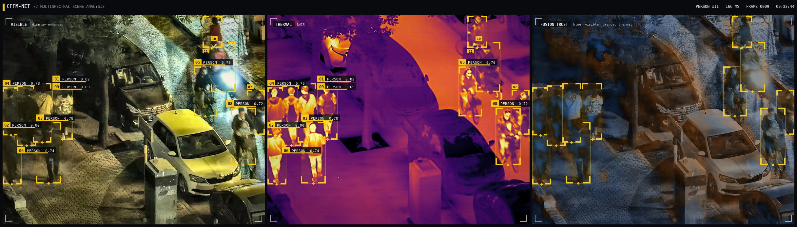](https://yolo-cross-feature-fusion-mamba-net.vercel.app)

<p align="center"><sub>Try it at <a href="https://yolo-cross-feature-fusion-mamba-net.vercel.app">yolo-cross-feature-fusion-mamba-net.vercel.app</a>.
Upload a visible and thermal pair or any photo, or pick a sample.</sub></p>

A thermal camera sees people in the dark. A visible camera sees texture, colour and print. Each one fails where
the other does not: glare, fog, a lens that drifts out of registration, a sensor that drops out. Most fusion
networks merge the two streams with weights that are fixed once training ends, so a failing camera keeps writing
into the fused representation.

CFFM-Net makes reliability part of the computation. Two YOLO26 backbones are fused at the pyramid levels by a
Mamba-style selective scan over **interleaved visible and thermal tokens**, and the discretisation step of every
token is **multiplied by a learned per-pixel estimate of how reliable its camera is at that location**. A selective
scan with step zero neither writes to nor erases its state, so the tokens of an unreliable camera are skipped. When a
camera is flagged as down, the skip is exact, because it follows from the algebra and not from what the network learned.

The project is finished and written up as a [journal manuscript](papers/CFFM-Net_IEEE_Journal.pdf). It has four phases:
still-image detection, video with a Temporal State Memory, a live camera runtime, and a multi-camera analytics layer.
This repository contains all of it:
- the model, and a fused Triton kernel for the gated scan;
- 70 tests;
- five hypotheses whose decision rules were written before any training;
- training runs on LLVIP, M3FD and KAIST, with three seeds for the headline comparison;
- an eleven-fault sensor benchmark;
- the Temporal State Memory, tracking, a live runtime with a stream monitor, and a multi-camera layer;
- a deployable demo;
- the manuscript, its supplement and nine venue packages;
- every figure, kept as TikZ source.

## At a glance

The outcome is mixed, and the manuscript reports it that way. At nano scale, with three seeds and 80 epochs, the
gated scan does not clearly beat a matched concatenation baseline on clean images. What the study does show is where
fusion pays, where the reliability mechanism helps, and where it does not.

| result | what it means |
|---|---|
| **66.2 vs 65.5 mAP** | CFFM-Net v2 against the matched concat baseline on LLVIP (three seeds). The margin is +0.8 ± 1.1 points, paired p = 0.37. A tie. |
| **53.9 vs 53.3 mAP** | the same comparison on M3FD. The margin is +0.6 ± 0.4 points, p = 0.11. v2 is ahead on all three seeds, which is weak evidence and not a significant result. |
| **+4.0 mAP** | fusion over the best single camera on M3FD (visible only, 49.9). Plain concat captures +3.4 of it, so most of the gain comes from fusing at all. |
| **+3.6 and −0.9** | the average margin of v2 over concat on M3FD under thermal-side and visible-side faults. The gate helps when thermal degrades and trails when visible does. |
| **fault training wins** | a concat baseline trained with fault augmentation keeps 86.8 % of its clean mAP under faults on M3FD, against 76.3 % for v2. Training on faults buys more than the gate. |
| **1.36×** | the latency of the concat baseline (45.0 vs 33.1 ms, RTX 4050 laptop GPU, FP16, batch 1). Round one measured 1.79× on a T4, inside the pre-registered budget of 2×. |
| **51.6 to 34.1 %** | KAIST miss rate under thermal noise without and with the Temporal State Memory. The memory was trained on faulty clips and the detector was not, so this does not isolate the recurrent state. |
| **0.29 s** | time for the stream monitor to flag a pulled thermal cable. The live runtime holds delay and GPU memory flat over ten minutes, at 12.4 frames per second on a nominal 30. |

Three things did not work, and the manuscript says so. The scan adds nothing measurable on LLVIP or on KAIST stills.
The memory does not help when the thermal camera is lost and does not improve tracking. A reliability loss tried in a
third round lowered accuracy.

## Method

<p align="center">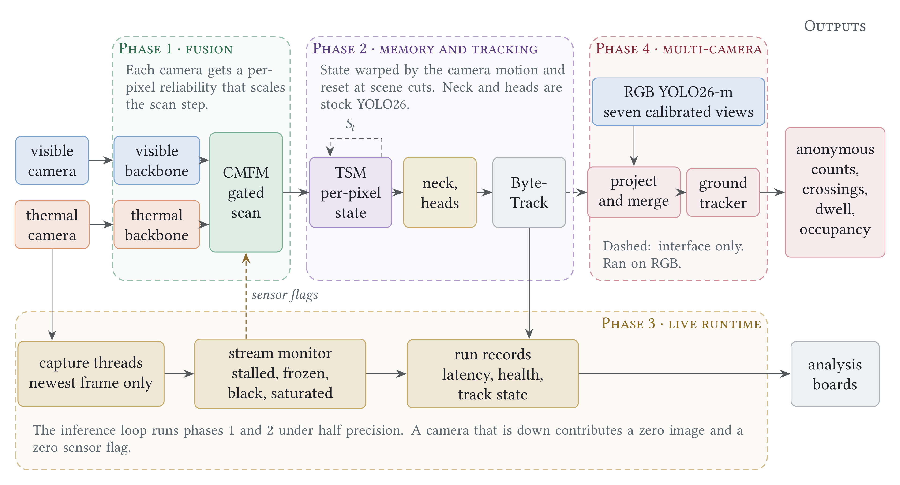</p>

<p align="center"><sub>The whole system. Two paired cameras feed a live runtime whose monitor turns stream health into sensor
flags. CFFM-Net with the Temporal State Memory produces detections and ByteTrack turns them into tracks. A separate
layer fuses detections from several calibrated cameras into anonymous ground-plane tracks and counts.</sub></p>

<p align="center">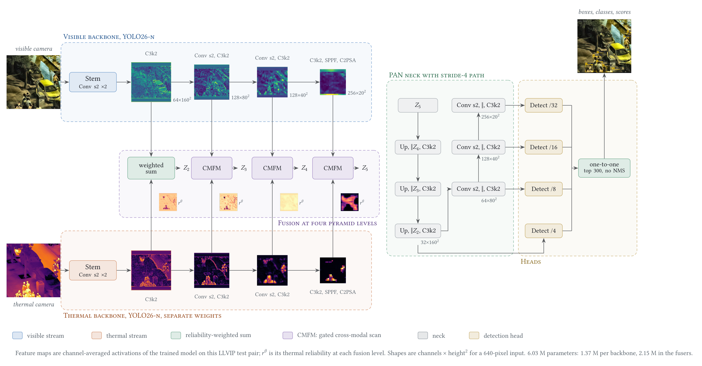</p>

<p align="center"><sub>CFFM-Net v1 as trained, drawn with the real activations of one LLVIP test pair. Each camera has its own
YOLO26-n backbone. The two streams never mix inside the backbones. They meet only in the fusion blocks at P2
(a reliability-weighted sum) and at P3–P5 (CMFM). The small maps are the thermal reliability r<sup>θ</sup> the
model assigned at each level. 6.03 M parameters, 18.4 GFLOPs at 640 px. v2 drops the stride-4 level and its head
(6.02 M, 16.5 GFLOPs).</sub></p>

**Reliability.** At each fusion level ℓ, a light head reads both feature maps and their disagreement and outputs one
trust map per camera:

```math
\big(r^{v}, r^{\theta}\big) = \sigma\Big(g\big([F^{v},\, F^{\theta},\, |F^{v}-F^{\theta}|]\big)\Big)\odot s,
```

where $`s\in\{0,1\}^{2}`$ are optional sensor-health flags. Nothing supervises $`r`$ directly. It is learned
only through the detection loss.

**Gated cross-scan.** The thermal map is warped onto the visible one by a learned offset of at most four cells. Both
are projected to $`d=c/2`$ channels and interleaved location by location,
$`x^{v}_{1}, x^{\theta}_{1}, x^{v}_{2}, x^{\theta}_{2}, \dots`$, giving $`L = 2HW`$ tokens. Each token's step is then
scaled by the reliability of the camera that produced it:

```math
\Delta_k = r_k\cdot\mathrm{softplus}\big(W_{\Delta}x_k + b_{\Delta}\big),\qquad
h_k = e^{\Delta_k A}\,h_{k-1} + \Delta_k B_k\,x_k,\qquad y_k = C_k h_k + D\,x_k .
```

The scan runs in four directions (rows and columns, each forwards and backwards), as in VMamba's SS2D, and the
directions are summed back on the grid.

**Residual form.** The block output is the reliability-weighted mean of its inputs plus a learned correction:

```math
Z = \frac{r^{v}F^{v} + r^{\theta}\tilde F^{\theta}}{\max\big(r^{v}+r^{\theta},\,10^{-2}\big)}
\;+\; W_o\Big[\mathrm{LN}\big(\mathrm{scan}_r(\cdot)\big),\ \mathrm{DWConv}(\cdot)\Big],
\qquad W_o \leftarrow 0 .
```

<p align="center">
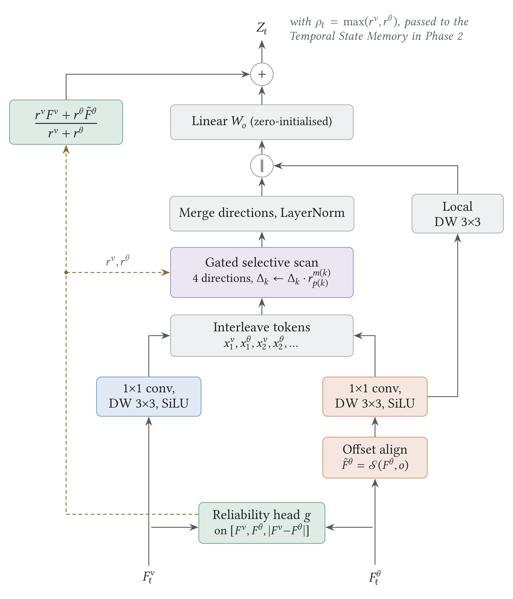
&nbsp;&nbsp;
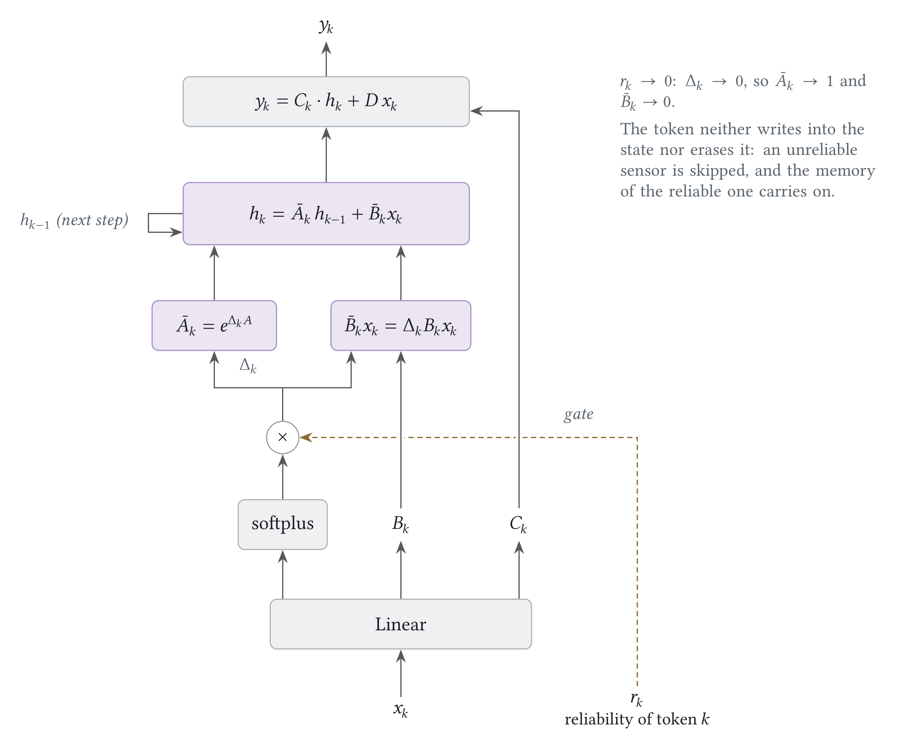
</p>

### Two properties that hold by construction, and are tested

1. **A camera with zero reliability cannot write to the state.** If $`r_k = 0`$, then $`e^{\Delta_k A} = I`$ and
   $`\Delta_k B_k x_k = 0`$, so token $`k`$ leaves $`h`$ unchanged. The tests set $`r^{\theta} = 0`$, perturb the thermal
   features, and check that the visible outputs of the scan do not move.
2. **A new block is exactly a reliability-weighted average.** $`W_o`$ starts at zero and the offset field starts at
   the identity, so training starts from a well-defined fusion and can only add to it. COCO-pretrained backbones go
   in without disturbance.

Both properties are checked in [`tests/`](cffm-net-pilot/tests). The 70 tests there also cover:
- equivalence of the two-pass PyTorch scan, the fused Triton kernel and the textbook recurrence, in values and gradients;
- direction ordering;
- the converters;
- the sensor-fault generators, the KAIST metric, the stream monitor and the multi-camera geometry;
- the Temporal State Memory and the video pipeline;
- the pre-registered decision rules.

## Results

All detection numbers are COCO mAP50-95 in percent, on LLVIP's full official test set of 3,463 pairs and on a seeded
80/20 split of M3FD (it has no official one). LLVIP trains on every third frame of its train set, because consecutive
frames are near duplicates. Every model uses YOLO26-n backbones, a 640 px input and COCO-pretrained weights. The
numbers in this section come from `papers/source/numbers.tex`, which a script generates from the result files.

### Phase 1: still images

<p align="center">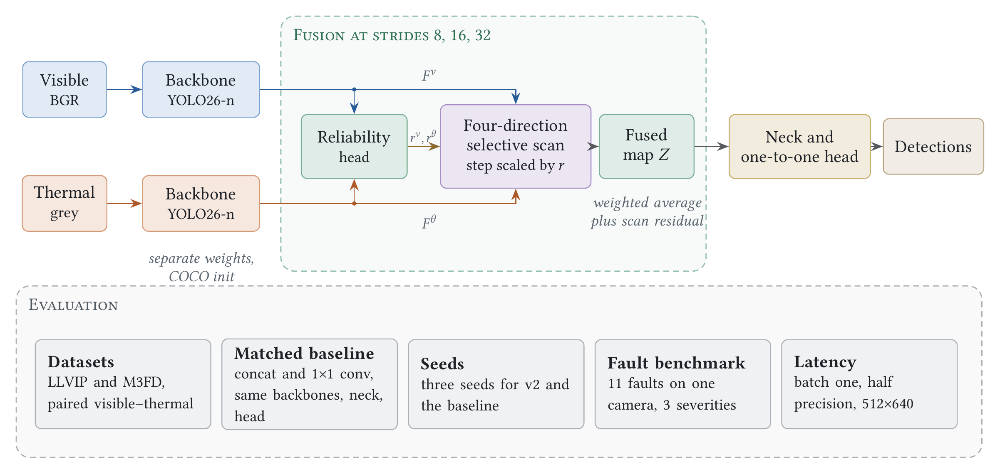</p>

**Clean accuracy.** The fusion rows are means over three seeds at 80 epochs. The LLVIP single-camera rows are one seed
at 30 epochs and are not matched to the fusion rows, so they support no conclusion about the gain from fusion there.
The M3FD single-camera rows are one seed at 80 epochs, matched in schedule but trained at twice the fusion batch size.

| model | LLVIP mAP | AP50 | M3FD mAP | AP50 |
|---|---:|---:|---:|---:|
| YOLO26-n, visible only | 52.0 | 90.0 | 49.9 | 78.0 |
| YOLO26-n, thermal only | 64.1 | 96.2 | 47.6 | 75.0 |
| two-stream concat, modality dropout | 65.5 ± 0.8 | 96.8 ± 0.4 | 53.3 ± 0.3 | 81.9 ± 0.3 |
| CFFM-Net v2 | **66.2 ± 0.8** | **96.9 ± 0.3** | **53.9 ± 0.1** | **82.7 ± 0.6** |
| margin of v2 over concat (points) | +0.8 ± 1.1 | +0.2 ± 0.5 | +0.6 ± 0.4 | +0.9 ± 0.7 |

Both fusion models use modality dropout, which blacks out one camera at random during training. On M3FD, v2 is ahead
of concat on all three seeds. The paired t-test gives p = 0.11 and the 95 % interval of the margin is −0.3 to +1.5
points, so this is weak evidence and not a significant result. On LLVIP the margin is smaller than its spread
(p = 0.37, interval −2.1 to +3.6) and v2 leads on two seeds of three. Read LLVIP as a tie. A thermal camera already
separates people from the background there, which leaves little for a better fuser to add.

Fusion itself is worth a lot on M3FD, where the visible camera is the stronger single camera. v2 is +4.0 ± 0.1 points
above it (+3.8 on its lowest seed) and concat is +3.4 ± 0.3 above it. Most of the gain is therefore available without
a gated scan. The single-camera value is one seed, so the real uncertainty of these gains is larger than shown.

On small objects, v2 gains +0.4 ± 0.3 points on M3FD and loses 0.4 on LLVIP. Neither is significant at three seeds.

**Cost.** Timed on an RTX 4050 laptop GPU in FP16 at batch 1:

| model | params | GFLOPs | median ms | p95 ms |
|---|---:|---:|---:|---:|
| YOLO26-n, one camera | 2.50 M | 5.9 | 25.8 | 47.5 |
| two-stream concat | 4.07 M | 9.7 | 33.1 | 42.5 |
| CFFM-Net v2 | 6.02 M | 16.5 | 45.0 | 54.7 |

v2 costs 1.48× the parameters, 1.70× the FLOPs and 1.36× the median latency of the concat baseline.

**Under sensor faults.** Eleven faults are applied to one camera of the test pairs at three severities: for the visible
camera darkness, glare, fog, noise, blur and a full drop, and for the thermal camera a full drop, a spatial shift,
banding noise, loss of contrast (thermal crossover) and dead pixels. Severity three is reported. On M3FD every number
is a mean over three seeds. On LLVIP the benchmark ran at seed zero only, and differences of one to three points there
are within seed noise.

On M3FD, v2 is ahead of concat on every thermal-side fault and behind on every visible-side one. Averaged over the
faults of each camera, the margin is **+3.6 ± 0.2 points** for thermal faults and **−0.9 ± 0.9 points** for visible
faults. Over all eleven it is +1.2 ± 0.5 points (paired p = 0.06, not significant), and the sign of the per-fault
margin agrees on all three seeds for only 6 of the 11 faults. A thermal shift is the worst fault for every model on
both datasets. v2 keeps 76.3 % of its clean mAP under faults on M3FD against 75.0 % for concat.

On LLVIP the picture is worse for the model. Its average margin over the eleven faults is −2.9 points, and v2 retains
70.3 % of its clean mAP against 75.5 % for concat. It loses most heavily to additive noise on either camera.
The gate is not a general robustness mechanism.

The strongest result of the benchmark concerns neither fusion design. A concat baseline **trained with fault
augmentation** keeps 86.8 % of its clean mAP on M3FD and 87.3 % on LLVIP, against 76.3 % and 70.3 % for v2, at a clean
mAP within one point of v2 (v2 minus it: +0.8 on M3FD). Its mean mAP across the faults is higher than v2's by 5.1 points
on M3FD and 11.9 on LLVIP. Training on faulty inputs buys more robustness than the reliability-gated scan does, and it
costs nothing in clean accuracy. Telling the model which camera dropped through the sensor flag changes nothing
measurable, which suggests that detectors trained with modality dropout already recognise a black input.

<p align="center">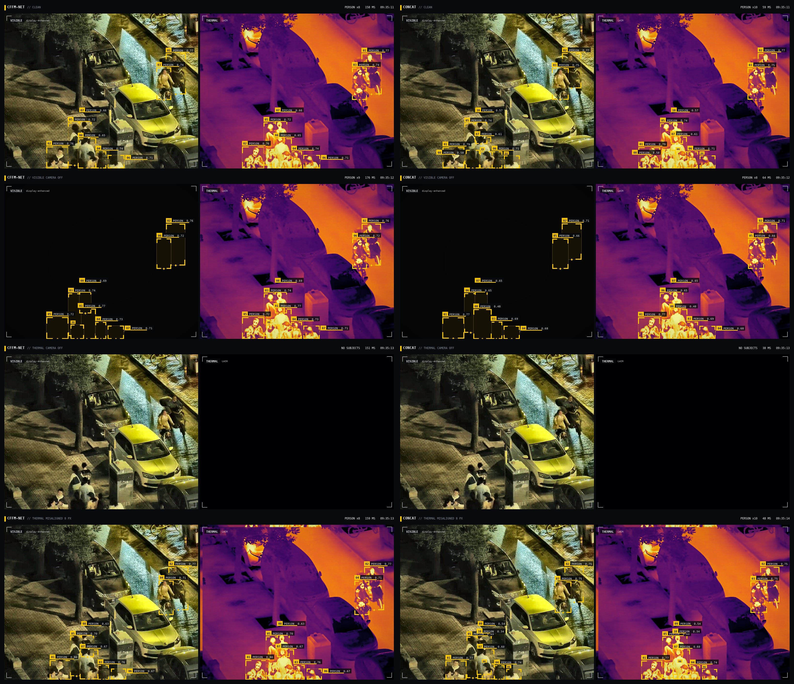</p>

<p align="center"><sub>Round-one models. Left: CFFM-Net. Right: concat. Rows from top: clean, visible camera off, thermal camera
off, thermal misregistered by 8 px.</sub></p>

**What the gate learned.**

<p align="center">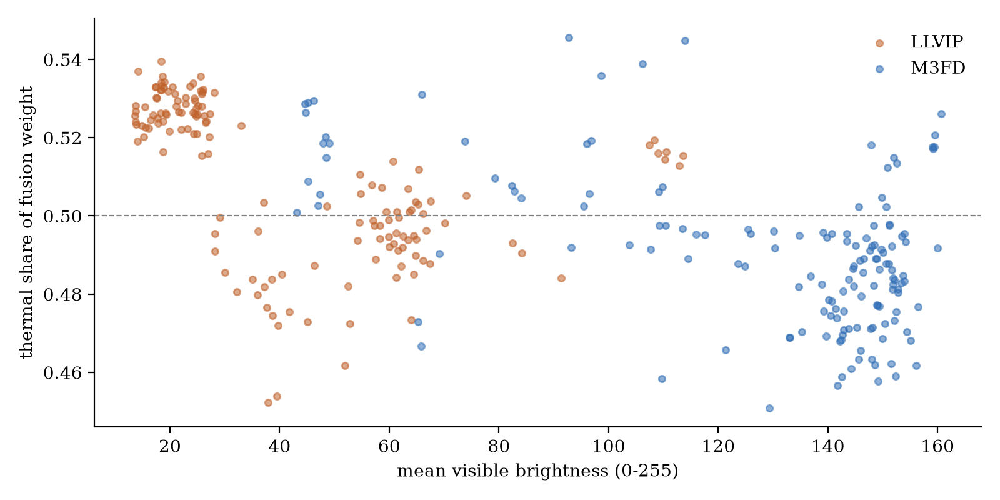</p>

Nothing tells the reliability head what darkness is. Even so, the thermal share of the fusion weight is highest in the
darkest LLVIP scenes and lowest in bright daytime M3FD scenes. The swing is small and the share stays close to one
half everywhere. At round one the gate is a mild prior and not a switch.

#### Round one

The first study was a single-seed, 30-epoch pilot of CFFM-Net v1, whose pyramid includes a stride-4 level. It was
negative. Against the matched concat baseline, v1 reached 62.9 against 64.9 mAP on LLVIP (−2.1 points) and 47.9 against
50.5 on M3FD (−2.6). Its pre-registered hypotheses came out as follows:

| | hypothesis | evidence | verdict |
|---|---|---|---|
| PH1 | fusion beats the best single camera at night | −1.2 AP vs thermal-only | inconclusive |
| PH2 | gating the step adds value | +0.3 clean; +1.3 less degradation on average | inconclusive |
| PH3 | the fusion helps 8–32 px objects (M3FD) | −2.5 AP in the 8–32 px bands | against |
| PH4 | the selective scan is needed | +0.1 AP vs a FLOP-matched gated-conv control | inconclusive |
| PH5 | latency at most 2× the two-stream baseline | 1.79× on a T4 | supported |

A difference under 1.5 AP points counts as inconclusive. One hypothesis is supported, one is contradicted and three
are inconclusive.

**Head control.** Part of the deficit came from the stride-4 head. Adding it lowers the concat baseline itself, so a
2 × 2 control separates the head from the fusion:

| LLVIP mAP | concat | CFFM-Net v1 | gap |
|---|---:|---:|---:|
| stride-4 head (P2–P5) | 63.2 | 62.9 | −0.3 |
| standard head (P3–P5) | 64.9 | 63.5 | −1.4 |

Matching the head explains most of the deficit at stride 4 and not with the standard head. v2 therefore returns to the
standard head, the one design decision made from evaluation results, on LLVIP at seed zero, then applied unchanged to
M3FD and to the other seeds. Removing the gate from v1 costs 0.3 points and replacing the scan with a gated
convolution of matched cost costs 0.1, both inside the noise of one seed.

**Degradation probe.** The same LLVIP test set with one fault applied to the round-one models. "Flagged" means the
model is told which camera is gone.

| fault | concat | v1, no gate | v1 |
|---|---:|---:|---:|
| none | 65.0 | 62.6 | 62.9 |
| visible darkened | 61.0 | 54.2 | 59.9 |
| visible removed, flagged | 61.8 | 57.0 | 59.5 |
| thermal removed | 0.3 | 0.7 | 2.2 |
| thermal removed, flagged | 0.3 | 0.7 | 17.4 |
| thermal misregistered 8 px | 29.7 | 31.1 | 32.6 |

The gate absorbs most of a darkened visible camera (59.9 against 54.2 without it), though concat is still ahead, and
the flag path works: with thermal removed and flagged, v1 keeps 17.4 mAP from the visible camera alone, where concat
has no way to be told. The learned offset helps within the misregistration it was trained on and nothing survives 16 px.

**Round three.** Adding fault training and a reliability loss gave v3 64.0 on LLVIP and 51.9 on M3FD at seed zero,
below v2 (−1.5 and −1.8) and below the fault-trained concat baseline (−2.4 and −0.9). The informative control, v3
without the reliability branch, reaches 67.2 and 53.3, so the branch costs 3.2 and 1.4 points. The reliability loss is
reported as a negative result and left out of the recommended recipe.

### Phase 2: video on KAIST

<p align="center">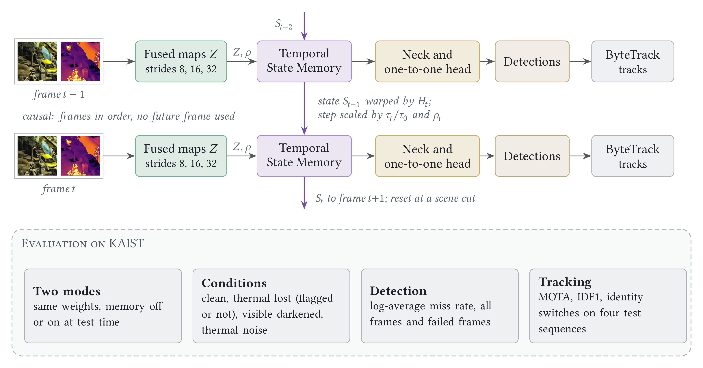</p>

KAIST is scored by log-average miss rate (lower is better) on the reasonable subset, using the original annotations and
our own implementation of the Caltech protocol, so the figures are not comparable with published ones. Each of the
runs here is a single run and carries no spread.

**Stills.** CFFM-Net v2 does not beat concat on KAIST. Over 2,262 test frames the miss rate is 20.3 % against 19.8 %,
and AP50 is 83.9 % against 84.6 %. By day concat leads by 1.2 points of miss rate and at night the two are level. Read it
as a tie with a slight lean to the baseline. The detectors are not competitive with published KAIST results.

**Temporal State Memory.** A recurrent block added after fusion, trained for three epochs on six-frame clips with the
detector frozen. Miss rate on all frames, with the memory off and on:

| condition | without memory | with memory |
|---|---:|---:|
| clean | 20.3 | 19.8 |
| thermal camera lost | 26.2 | 25.9 |
| visible camera darkened | 30.0 | 28.2 |
| thermal noise | 51.6 | 34.1 |

The large effect is under thermal noise: miss rate falls from 51.6 % to 34.1 %, and on the failed frames alone from
75.4 % to 45.9 %. This comes with a confound the manuscript states. The memory was trained on clips with injected faults and
the detector under it was not, so the gain may come from the block learning to suppress noisy features and not from
carrying state across frames. A stateless adapter of the same size, trained on the same clips, would separate the two
and has not been run. With a darkened visible camera the memory helps on the failed frames (39.7 % to 36.6 %), most of
all at night. **When the thermal camera is lost it does not help:** on the failed frames the miss rate is 32.3 % with
memory against 31.6 % without, and declaring the loss through the sensor flag leaves that unchanged. A four-second
outage appears too long for this memory to bridge.

**Tracking.** The memory does not improve tracking. On four test sequences with 175 annotated persons, clean MOTA
goes from 44.5 % to 42.5 % and IDF1 from 64.3 % to 61.3 %. With the thermal camera failing, MOTA is 34.7 % against 35.3 %
and IDF1 50.7 % against 53.6 %. The memory is reported as a detection-time component whose benefit shows under visible
darkness and thermal noise.

### Phase 3: live runtime

<p align="center">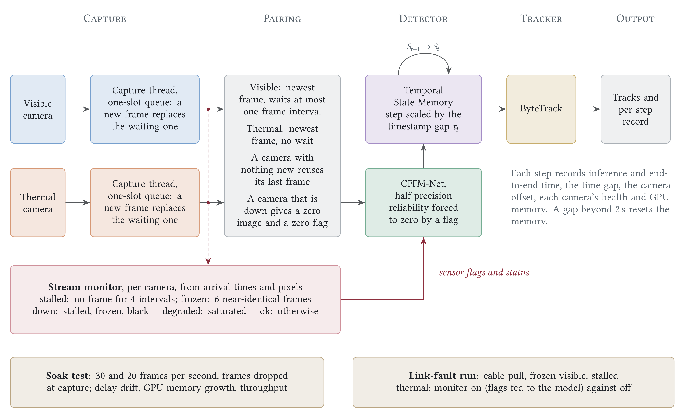</p>

Recorded KAIST sequences are replayed at real speed as the two cameras, so every run is repeatable and the faults are
exact. The runtime runs CFFM-Net v2 with the memory and ByteTrack on the same RTX 4050 laptop GPU. A frame the model
cannot take is dropped at capture and never queued.

**Soak test.** Over ten minutes (594 s) at a nominal 30 frames per second, the end-to-end delay drifts by +0.3 ms and
GPU memory changes by −1 MB, so neither grows. The runtime is **not real time at the camera rate on this hardware.** It
processes 12.4 frames per second and drops 58.8 % of captured frames. The median end-to-end delay is 94.4 ms with a
95th percentile of 117.9 ms, and the median inference time with memory and tracking is 70.9 ms. At 20 frames per
second for 117 s it processes 12.7 and drops 36.3 %. The bounded delay is bought with temporal resolution.

**Link faults and the stream monitor.** A 110 s scripted run pulls the thermal cable for 6 s, freezes the visible
camera for 6 s and stalls the thermal stream for 3 s, with 10 % random frame drops and a 60 ms thermal delay. The
monitor flags a cable pull after 0.29 s and clears it 0.19 s after the camera returns, flags a stall after 0.31 s,
and flags a frozen visible camera after 0.69 s. It is not free of false alarms: the thermal stream is marked down outside
the scripted windows in 4.3 % of records in the cable-pull run and 6.1 % in the stall run. Feeding its flags to the
model gives no measured accuracy benefit: the miss rate is 27.9 % with the monitor on and 27.1 % off. The monitor
detects and clears link faults quickly, and the manuscript does not claim that its flags improve detection.

### Phase 4: multi-camera analytics

<p align="center">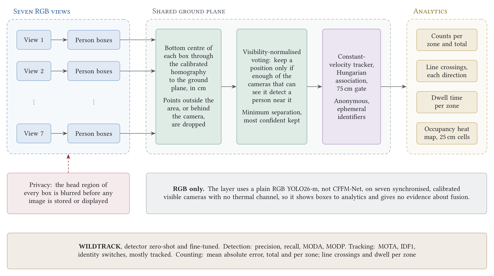</p>

The multi-camera layer maps person boxes from several calibrated cameras onto a ground plane, merges them by
visibility-normalised voting, tracks them with a constant-velocity tracker and reports aggregate analytics: counts per
zone, line crossings, dwell time and an occupancy map. Identifiers are ephemeral and anonymous, and the head region of
every box is blurred before anything is stored or shown.

It is evaluated on WILDTRACK, which has seven synchronised, calibrated **visible** cameras and no thermal channel, with a
plain RGB YOLO26-m detector. These results show that the analytics stage works from boxes to counts. They say nothing
about whether visible-thermal fusion improves analytics, which would need paired multi-camera thermal data.

| | MODA | recall | precision |
|---|---:|---:|---:|
| detector zero-shot from COCO | 42.5 % | 46.5 % | 92.1 % |
| detector fine-tuned on WILDTRACK | 77.4 % | 87.3 % | 89.8 % |

On the ground-plane tracks the system reaches MOTA 79.4 % and IDF1 84.9 % with 18 identity switches, and tracks 25 of 41
people for most of their presence. The total count has a mean absolute error of 1.43 people on a mean of 23.8 per frame, a
relative error of 6.0 %.

## Engineering

**A fused kernel for the gated scan.** At stride 8, the scan runs over 12,800 interleaved tokens per direction. The
two-pass chunked PyTorch scan is exact but memory-bound. [`scan.py`](cffm-net-pilot/src/cffm/scan.py) adds a Triton
kernel for the forward and backward passes, which holds the state in registers. On a T4 it takes 31 ms against
978 ms, and one CFFM-Net training step drops from 2.47 s to 0.285 s. When `mamba_ssm` is present it is used, then
Triton, then PyTorch. All three agree with the textbook loop in values and gradients.

**Numerics.** A recurrence over twelve thousand tokens overflows FP16. The whole scan path therefore runs in FP32
under AMP: projections, steps, state and the fusion weights. The weighted mean is computed in FP32 with its
denominator floored at $`10^{-2}`$. Before that floor, modality dropout could drive both reliabilities near zero and
produce a NaN, which is what invalidated an early LLVIP v2 run.

**FLOP accounting.** Standard profilers do not count the element-wise work of a selective scan. The reported
GFLOPs add about 11 FLOPs per token, channel and state for the two passes. The gated-conv control of PH4 is matched
to CFFM-Net v1 on this full count: 18.30 against 18.39 GFLOPs.

**Data audit.** On LLVIP, 55% of frames are dark (mean below 50 of 255) and the median person is 71 px. On M3FD,
32% of objects are under 16 px and 59% are under 32 px. The 99th-percentile misregistration between the two cameras
is 4.7 px on LLVIP and 7.8 px on M3FD. These numbers set the range of the offset warp and the choice of size bands.

**One source for every number.** [`papers/source/numbers.tex`](papers/source/numbers.tex) is generated from the result
files by [`collect_numbers.py`](papers/source/tools/collect_numbers.py), and the manuscript tables are built from those
macros, so no result is typed by hand.

## Reproduce

```bash
git clone https://github.com/riteshroshann/yolo-cross-feature-fusion-mamba-net
cd yolo-cross-feature-fusion-mamba-net/cffm-net-pilot
pip install torch torchvision --index-url https://download.pytorch.org/whl/cu126
pip install -e ".[dev]"
python -m pytest -q
python tools/run_notebooks.py
```

Every run, with its dataset, model, batch size and schedule, is declared in
[`configs/pilot.yaml`](cffm-net-pilot/configs/pilot.yaml). The notebooks are generated from one script,
[`tools/build_notebooks.py`](cffm-net-pilot/tools/build_notebooks.py), and can be pushed to Kaggle and watched from
the command line:

```bash
python tools/make_zip.py
python tools/kaggle_run.py upload
python tools/kaggle_run.py push 07
python tools/kaggle_run.py wait 07
```

Later phases ran locally on a laptop RTX 4050 with [`tools/train_local.py`](cffm-net-pilot/tools/train_local.py). An
interrupted run resumes from its last checkpoint. Runs that already finished are reused, not retrained. The full
walkthrough is in [`cffm-net-pilot/README.md`](cffm-net-pilot/README.md). To rebuild the manuscript, run
`tectonic -X compile main.tex` in [`papers/source`](papers/source).

**Demo.** The live demo is at [yolo-cross-feature-fusion-mamba-net.vercel.app](https://yolo-cross-feature-fusion-mamba-net.vercel.app).
To run it yourself, `python cffm-net-pilot/demo/app.py` starts the Gradio app behind it. Upload a visible and
thermal pair, or any photo, and get the analysis board: numbered subjects, per-camera panels and the trust map.
[`web/`](cffm-net-pilot/web) is the static front-end; the *backend* field at the bottom of its demo panel points it
at any running copy of the app.

<p align="center">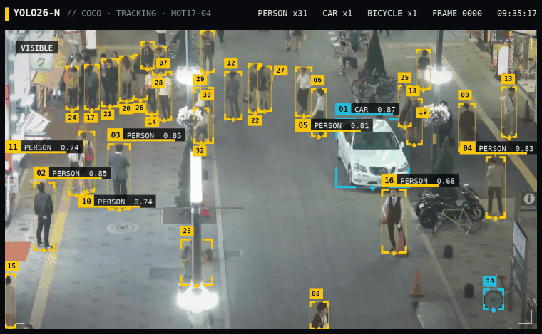</p>

<p align="center"><sub>The tracking pipeline on MOT17-04: YOLO26-n (COCO, visible only) with ByteTrack. It previews the
video stack that CFFM-Net and the Temporal State Memory run in, and is not a CFFM-Net result.</sub></p>

## Status

All four phases are built and measured, and the manuscript is written. Nine venue packages are ready under
[`submissions/`](submissions): four journals, four conferences and arXiv.

| phase | | state |
|---|---|---|
| 0 | environment, data, audit | done |
| 1 | still images: three-seed comparison, eleven-fault benchmark, round-one ablations | done; the gate is a tie on clean accuracy and helps on thermal-side faults on M3FD |
| 2 | video: KAIST stills, Temporal State Memory, tracking | done; the memory helps under thermal noise and visible darkness, not under thermal loss or in tracking |
| 3 | live cameras: capture threads, stream monitor, ten-minute soak | done; delay and memory are bounded, throughput is 12.4 frames per second on a nominal 30 |
| 4 | multiple cameras on one ground plane, anonymous counts only | done on RGB-only WILDTRACK; no thermal multi-camera data was available |
| next | fault benchmark of a scan-based model trained with fault augmentation against the fault-trained concat baseline, three seeds on both datasets | not run |

That last experiment is the one that would settle whether the gate adds anything for robustness once training is
matched. The paper names it as the next experiment that matters.

<p align="center">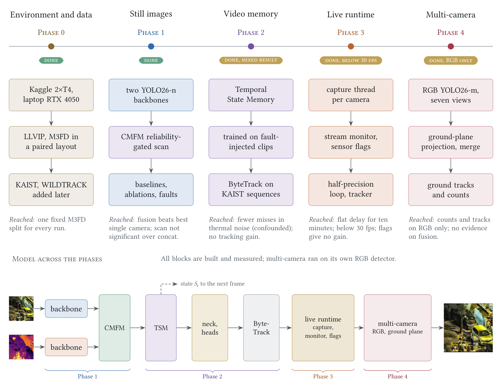</p>

## Repository

```
cffm-net-pilot/          the code, notebooks, configs, tests, results, demo and web front-end
  src/cffm/              scan.py, blocks.py, model.py, data.py, train.py, tsm.py, faults.py, kaist.py,
                         video.py, stream.py, pipeline.py, multicam.py, report.py, hud.py
  configs/               pilot.yaml (every run) and models/ (CFFM-Net v1 to v3, ablations, baselines)
  notebooks/             phases 0 to 4: environment, still images, video, live, multi-camera
  tests/                 70 tests
  tools/                 notebook builder, Kaggle runner, local training, fault and latency runs
  results/               tables, hypothesis verdicts, probe, phase 2 to 4 results, showcase boards
  docs/figures/          every diagram, as TikZ source
papers/                  the manuscript (CFFM-Net_IEEE_Journal.pdf and its supplement),
                         source/ (LaTeX, numbers.tex, tables), and the index and downloader for the
                         174 works the dossier cites
submissions/             venue packages: journals/ (IEEE TIP, IEEE TCSVT, Information Fusion,
                         Pattern Recognition), conferences/ (CVPR, ICCV, WACV, BMVC 2027/28) and arxiv/,
                         each with its PDFs, LaTeX source and template
docs/atlas/              Architecture Atlas: YOLOv1 to YOLO26, SSMs to VMamba, CFFM-Net, scope
docs/dossier/            research dossier: survey, method, evaluation plan
docs/novelty/            what the pilot adds over prior visible-thermal fusion
docs/datasets/           datasets, licences and how to obtain them
study-prep/              learning path, lecture links, 37 papers by stage (fetch.py), study guide
```

## Citation

```bibtex
@misc{roshan2026cffmnet,
  title        = {{CFFM-Net}: Reliability-Gated Mamba Fusion of Visible and Thermal Images for Detection,
                  Tracking and Multi-Camera Analytics},
  author       = {Roshan, Ritesh},
  year         = {2026},
  howpublished = {\url{https://github.com/riteshroshann/yolo-cross-feature-fusion-mamba-net}}
}
```

GitHub's *Cite this repository* button reads the same entry from [CITATION.cff](CITATION.cff).

## License

Copyright © 2026 Ritesh Roshan. The code is released under the [GNU AGPL v3.0](LICENSE), as Ultralytics YOLO,
on which it builds, requires. The documents, figures, tables and README text are released under
[CC BY 4.0](LICENSES/CC-BY-4.0.txt). Both licences let anyone reuse the work, provided they credit it.

The dataset images in the showcase and demo stay under their own terms: LLVIP and M3FD are for non-commercial
research, KAIST and WILDTRACK are distributed by their authors under their own terms, and MOT17 is CC BY-NC-SA 3.0. The cited papers are not
redistributed here. [NOTICE.md](NOTICE.md) lists exactly what is covered and what is not.

## Acknowledgements

This work builds on these projects and datasets:
- [Ultralytics YOLO26](https://github.com/ultralytics/ultralytics);
- [Mamba](https://github.com/state-spaces/mamba) and [VMamba](https://github.com/MzeroMiko/VMamba);
- [ByteTrack](https://github.com/ifzhang/ByteTrack);
- [LLVIP](https://bupt-ai-cz.github.io/LLVIP/), [M3FD](https://github.com/JinyuanLiu-CV/TarDAL),
  [KAIST](https://soonminhwang.github.io/rgbt-ped-detection/), [WILDTRACK](https://www.epfl.ch/labs/cvlab/data/data-wildtrack/)
  and [MOT17](https://motchallenge.net/data/MOT17/).

Compute came from Kaggle's free T4 GPUs and one laptop RTX 4050.

Engineered by Ritesh Roshan.
